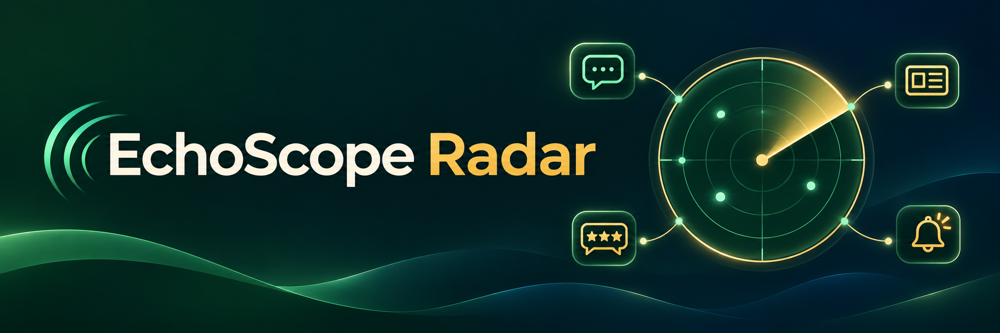

# EchoScope Radar

Centro de monitoreo para comentarios, reseñas, feeds y chats de directos. Cada panel muestra los mensajes recibidos, incluidas las capturas sin coincidencias. Las reglas resaltan términos en el texto original y agrupan sus apariciones por alerta.



## Versión 0.15.0 · Inicio automático, Windows y Linux

[Inicio automático, distribuciones y dominio](docs/inicio-automatico-y-distribuciones.md). Los paquetes Windows ZIP y Linux TAR.GZ se generan en `dist/0.15.0/`; incluyen instaladores de inicio y usan configuración persistente `instalacion.env`.

[Auditoría de 16 medios, cobertura y registros](docs/prensa-y-segundo-plano.md). Se incorpora lectura pública de comentarios de Montevideo Portal, seguimiento de todas las noticias del recurso sin exigir coincidencia en el título, ejecución en segundo plano sin ventana adicional y persistencia de chats. Los comentarios que requieren claves o una integración pendiente se informan como tales.

En Windows, abrí **Abrir EchoScope Radar.cmd** para seguir prensa, YouTube, Bluesky y foros autorizados desde el navegador. Abrí **Probar EchoScope Radar.cmd** para practicar con datos simulados. En **Reseñas**, elegí **Cómo recibir reseñas** para empezar con el enlace de una página. **Descargar PDF** agrupa las alertas del período por publicación original y muestra su estado actual de revisión.

- [Guía para personal administrativo](docs/uso-administrativo.md)
- [Pruebas y notas de prensa de Uruguay](docs/fuentes-uruguay.md)
- [Historial de versiones](CHANGELOG.md)

En **Base de datos**, combiná filtros, abrí el contenido almacenado y exportá la consulta a Excel, CSV o PDF. La tabla de consulta es de solo lectura y respeta la cuenta del servidor. Almacenamiento y mantenimiento muestra la ruta real y permite previsualizar una limpieza por antigüedad. [Capacidad y acceso externo](docs/almacenamiento-y-acceso.md). [Guía de consulta y prensa](docs/consulta-visual-y-prensa.md).

Para generar la carpeta distribuible en Windows, ejecutá `powershell -NoProfile -File scripts/build-windows.ps1` desde el proyecto. El resultado queda en `dist/0.15.0/EchoScopeRadar/` y se abre con `EchoScopeRadar.exe`. Conservá la carpeta `_internal`.

- [Fuentes de Uruguay y requisitos de conexión](docs/fuentes-uruguay-conexiones.md)
- [Cómo consultar directamente la base](docs/consulta-base-datos.md)
- [Validación de comentarios y cuentas propias](docs/validacion-comentarios.md)

Copiá [.env.example](.env.example) a .env para configurar rutas, puertos, límites y dirección de base de datos. También podés indicar --env-file con un archivo externo. El demo conserva su base separada.

- [Documento funcional](docs/documento-funcional.md)
- [Documento técnico, configuración y MER](docs/documento-tecnico.md)
- [Auditoría inicial](docs/auditoria-inicial.md)
- [Informe de validación Windows y Ubuntu](docs/informe-validacion.md)

Para instalar el modo compartido con inicio de sesión HTTPS, seguí la [guía del servidor](docs/servidor.md).

En Windows y Ubuntu, podés ejecutar desde código fuente con `uv sync --locked --extra youtube` y `uv run --no-sync echoscope-web`. Agregá `--demo` para practicar. La aplicación web escucha en la propia computadora. Si el puerto está ocupado, indicá otro con `--port 8770`. La interfaz anterior sigue disponible con `uv run --no-sync echoscope-desktop` o `EchoScopeRadar.exe --desktop`.

El modo de terminal y los comandos de las secciones siguientes sirven para operación técnica.

## Demo local

Requiere Python 3.12 y `uv`. Los mismos comandos funcionan en Windows Terminal y Ubuntu.

```sh
uv sync --locked
uv run echoscope demo
```

El demo ejecuta dos tareas periódicas y un chat en vivo simulado. Inyecta un fallo transitorio en reseñas, una desconexión recuperable en el chat y mensajes repetidos en los límites de lote. Podés probarlo sin interfaz con `uv run echoscope demo --headless --seconds 10`.

| Tecla | Acción |
|---|---|
| Tab / Shift+Tab | Cambiar de panel |
| Flechas / Enter | Seleccionar un mensaje y abrir sus detalles |
| P / R / G | Pausar o reanudar la tarea seleccionada o todas las tareas |
| C | Ver ciclos y cambiar intervalo, habilitación o estado |
| F / M / A | Filtrar, ampliar el panel o enfocar alertas |
| Espacio / Repág / Fin | Congelar la vista, cargar historial o volver a los últimos mensajes |
| Q | Salir |

La TUI usa el mismo motor que `run`. Al salir de una TUI integrada también termina su motor local. El comando `run` funciona de forma autónoma y se detiene con Ctrl+C o SIGTERM cuando el sistema lo entrega. Cada base admite un solo motor escritor. `status`, `history` y `replay` pueden consultar esa base mientras está activa.

## Fuentes configurables

Guardá el ejemplo incorporado como `radar.yaml` y revisá los recursos antes de habilitarlos. En Ubuntu o PowerShell 7 se puede redirigir directamente. En Windows PowerShell 5 usá `| Set-Content -Encoding UTF8 radar.yaml`.

```sh
uv run echoscope config example --name public > radar.yaml
uv run echoscope config validate radar.yaml
uv run echoscope config apply radar.yaml
uv run echoscope job run-once usgs
uv run echoscope history --source usgs --limit 3
uv run echoscope console
```

El Atom del [U.S. Geological Survey](https://earthquake.usgs.gov/earthquakes/feed/v1.0/atom.php) ofrece reportes de sismos y sirve para verificar tráfico real sin registro. Para comentarios o reseñas, configurá un RSS 2.0 o Atom del sitio autorizado y, si corresponde, `kind: COMMENT` o `kind: REVIEW` dentro de `params`. Usá un dominio HTTPS público. Las entradas necesitan un ID, GUID o enlace estable. El conector procesa el texto publicado por el feed, usa ETag y Last-Modified cuando existen y conserva el enlace de origen.

Para un feed protegido, agregá `credential: {kind: bearer, env: ECHOSCOPE_FEED_TOKEN}` a la fuente y cargá esa variable en el entorno del proceso desde tu gestor de secretos. `echoscope doctor` informa si la referencia tiene un valor. `echoscope doctor --network usgs` realiza una lectura diagnóstica explícita. Dejá pasar al menos 60 segundos entre lecturas de prueba de USGS.

Para YouTube Live instalá `uv sync --locked --extra youtube`. En el ejemplo, cambiá `video_id` por el ID de un directo y habilitá la tarea `directo`. Inyectá una clave de proyecto en `ECHOSCOPE_YOUTUBE_KEY` o seleccioná `kind: oauth` y una variable con un token vigente. La clave o token deben tener acceso a la API de YouTube. Volvé a aplicar el archivo con el motor detenido y abrí la consola. Un chat pendiente, cerrado, sin permisos o limitado por cuota se muestra como estado operativo. Un hueco posible después de una reconexión aparece como `CAPTURA PARCIAL`. Los chats de YouTube se guardan en la base; el perfil incorporado conserva siete días. Los conectores no persistentes de otras clases conservan una ventana de sesión de hasta 200 mensajes por tarea. [Guía oficial de YouTube Live](https://developers.google.com/youtube/data/live/streaming-live-chat)

La cobertura depende del recurso y del acceso que ofrece cada proveedor. La mesa web incluye comentarios de videos y chat de directos de YouTube. Instagram Live, Twitch y otros conectores de plataforma pertenecen a los siguientes hitos.

## Operación y datos

```sh
uv run echoscope status --executions
uv run echoscope history --job usgs --text Alaska --limit 25
uv run echoscope replay --source usgs --after 0 --limit 50
uv run echoscope replay --rules radar.yaml --rule-set avisos --limit 50
```

La base normal y la de demo se guardan por separado en el directorio local de datos del usuario. Pasá `--db RUTA` antes del comando para elegir una base explícita. Usá disco local con SQLite WAL. `config apply` reemplaza la configuración activa de forma atómica. Los cambios de intervalo o reglas conservan el cursor de una tarea. Los cambios de recurso, conector o credencial referenciada reinician su cursor. `job clone ID NUEVO_ID` crea una tarea independiente y deshabilitada inicialmente.

El historial y el replay leen solo datos locales que siguen dentro de su retención. `--rules` y `--rule-set` ensayan reglas en memoria. La retención de las fuentes persistentes es de 30 días por defecto y se puede acortar con `retention_days`. Con el motor detenido, `echoscope data purge --source ID` elimina las capturas locales y sus alertas derivadas. Si la fuente vuelve a entregar el mismo contenido en un ciclo posterior, puede volver a capturarse. Revisá la política aplicable y los respaldos antes de habilitar una fuente real.

## Desarrollo y verificación

```sh
uv sync --locked --extra youtube
uv run ruff check src tests
uv run pytest -m 'not internet and not performance'
```

Para verificar el feed público desde un entorno con red, definí `ECHOSCOPE_TEST_INTERNET=1` y ejecutá `uv run pytest -m internet`. Para ejecutar la carga reproducible de diez tareas y 10.000 mensajes, definí `ECHOSCOPE_TEST_LOAD=1` y ejecutá `uv run pytest -s -m performance`. La prueba mide la actualización de paneles visibles y la navegación bajo carga usando Textual Pilot.

Las migraciones Alembic están en `src/echoscope/storage/migrations/` para que también estén disponibles al instalar el paquete. El proceso escritor las aplica al abrir la base bajo bloqueo exclusivo. Hacé un respaldo antes de actualizar una base existente. El workflow de CI instala desde el lockfile y ejecuta las pruebas locales en Windows y Ubuntu.

El conector de YouTube incluye un subconjunto compatible del esquema protobuf publicado por Google. Se puede regenerar con `grpcio-tools` 1.85.1 y `python -m grpc_tools.protoc -I src --python_out=src src/echoscope/connectors/stream_list.proto`. [Código de ejemplo y licencia](https://developers.google.com/youtube/data/live/streaming-live-chat)
