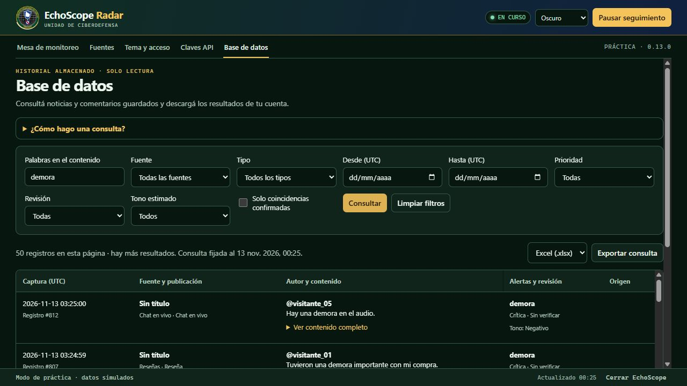

> Desde 0.14.2 también se puede consultar capacidad y previsualizar una limpieza por antigüedad. [Almacenamiento y acceso real](almacenamiento-y-acceso.md). La tabla de resultados continúa siendo de solo lectura.

# Consulta visual y comentarios de prensa

EchoScope Radar 0.13.0 · 13 de noviembre de 2026

## Consultar lo guardado

1. Abrí la pestaña **Base de datos**.
2. Combiná palabras del contenido, fuente, tipo, fechas de captura UTC, prioridad, revisión y tono. Dejá un campo vacío para incluir todos sus valores.
3. Presioná **Consultar**. Cada página muestra hasta 50 registros. **Siguiente** y **Anterior** recorren la misma consulta sin desplazar las filas por mensajes nuevos.
4. **Ver contenido completo** abre el texto guardado. **Abrir origen** lleva al sitio original. El tipo permite distinguir la nota del comentario de un lector.
5. Para revisar opiniones relacionadas, elegí **Comentario de prensa** y activá **Solo coincidencias confirmadas**. Podés priorizar tono negativo o revisión sin verificar. El tono se estima por reglas y no sustituye una evaluación humana.
6. Seleccioná **Excel**, **CSV** o **PDF**, y presioná **Exportar consulta**. Se exportan todos los resultados de los filtros aplicados, no únicamente la página visible.

La vista no permite modificar ni eliminar registros. No ejecuta SQL escrito por usuarios ni muestra cuentas, contraseñas, claves API o cursores. En servidor cada sesión consulta únicamente la base de su cuenta. Las fuentes eliminadas pueden conservar registros hasta la retención; se pueden consultar dejando Todas las fuentes.

Cada fila representa una observación almacenada. La misma publicación puede aparecer en distintas tareas o versiones; el conteo de registros no equivale necesariamente a autores o comentarios únicos.

La fecha de consulta fija el límite superior de captura. Si cambiás un filtro, debés presionar Consultar nuevamente antes de exportar. Las revisiones reflejan su estado al efectuar cada operación; la retención o una purga pueden retirar registros entre consultas.

## Exportaciones

- **Excel:** libro con encabezados, filtros de columnas, primera fila fija, ajuste de texto y hoja Información. Hasta 5.000 registros o 20 MB. Excel admite 32.767 caracteres por celda; para textos más largos usá CSV.
- **CSV:** UTF-8 con marca de codificación y separador punto y coma. Conserva el texto completo. Los valores que podrían interpretarse como fórmulas llevan un apóstrofo de protección.
- **PDF:** documento A4 con conteos y registros agrupados bajo su publicación, con fuente, enlace, autor, fecha, contenido, términos y revisión. Hasta 1.000 registros. Para imprimir un resumen breve de alertas, sigue disponible Descargar PDF desde la mesa de monitoreo.

Al superar un límite, la operación pide acotar los filtros; no entrega un archivo silenciosamente incompleto. La consulta muestra solo capturas persistidas y vigentes. Las vistas previas y los chats de YouTube conservados solo durante la sesión no están en SQLite.

## Recorrido de prensa

1. La fuente de terceros descubre una noticia cuyo **título** coincide de forma confirmada con la lista blanca. Las cuentas propias mantienen su modalidad independiente del título.
2. Se lee el contenido accesible de la nota cuando existe un cuerpo reconocible en HTML, además del extracto del feed.
3. Se consultan los comentarios por feed específico, WordPress o Disqus. También se incorporan comentarios identificables en el HTML estático.
4. Cada comentario y respuesta se evalúa individualmente. Una coincidencia en la noticia no convierte automáticamente todos sus comentarios en alertas.
5. Los mensajes conservan la publicación original. Historial, alertas y consulta visual permiten estudiar los comentarios coincidentes sin confundirlos con el cuerpo de la noticia.

El lector distingue la clase `post` de una noticia de un `post` dentro de una sección de comentarios. Reconoce contenedores de conversación, identificadores de comentario, texto del comentario, autor y fecha; también marcado Schema.org Comment. Una clase genérica por sí sola no basta para clasificar el texto como opinión de un lector. [Schema.org Comment](https://schema.org/Comment) · [WordPress Comments](https://developer.wordpress.org/rest-api/reference/comments/).

La descarga HTML usa HTTPS público, validación de direcciones, sin redirecciones ni ejecución de scripts, con un límite de 1 MiB descomprimido y de complejidad del documento. Se capturan hasta 200 comentarios identificables por página. Un límite alcanzado señala captura parcial. No se pulsa Cargar más ni se resuelven comentarios inyectados por JavaScript, iframes o accesos restringidos; necesitan un adaptador o API específico. Verificá que la fuente permita su consulta antes de habilitarla.

## Comprobación pública

El HTML público de la nota de Brecha https://brecha.com.uy/una-loteria/ devolvió un cuerpo reconocible y cero comentarios estáticos identificables. La portada de Ejército del Uruguay también devolvió un cuerpo reconocible y cero comentarios identificables. Esto comprueba lectura HTML, no demuestra que esos sitios no tengan comentarios por otro mecanismo. El recorrido con comentarios, respuestas y coincidencias se prueba con fixtures reproducibles.

## Validación de la entrega

- Windows 11 / Python 3.12: 53 pruebas aprobadas y dos pruebas optativas de Internet/rendimiento excluidas.
- Ubuntu 24.04 en contenedor: 52 pruebas aprobadas, una específica de Windows omitida y las dos optativas excluidas. La red se deshabilita durante la ejecución.
- Navegador: pestaña, nombres de fuentes, consulta por palabras y tabla de resultados verificados visualmente con datos simulados.
- Consulta y exportaciones: paginación de 55 registros, exportación completa en tres formatos, fecha de consulta estable ante nuevas capturas y aislamiento de cuentas HTTPS.
- Seguridad: solicitudes sin token rechazadas; SQL libre y campos desconocidos rechazados; texto externo exportado como texto, sin fórmulas ejecutables. El nombre del autor se excluye del cuerpo analizado del comentario HTML.
- PDF: ejemplo A4 renderizado y revisado visualmente. El PDF de consulta es un detalle de registros; el resumen de alertas para impresión continúa en la mesa.

Se incorporan openpyxl 3.1.5 y et-xmlfile 2.0.0, ambos con licencia MIT según sus metadatos instalados. Las versiones están fijadas en uv.lock. El informe de dependencias anterior conserva su fecha y no representa una nueva auditoría de vulnerabilidades de estos dos paquetes.
