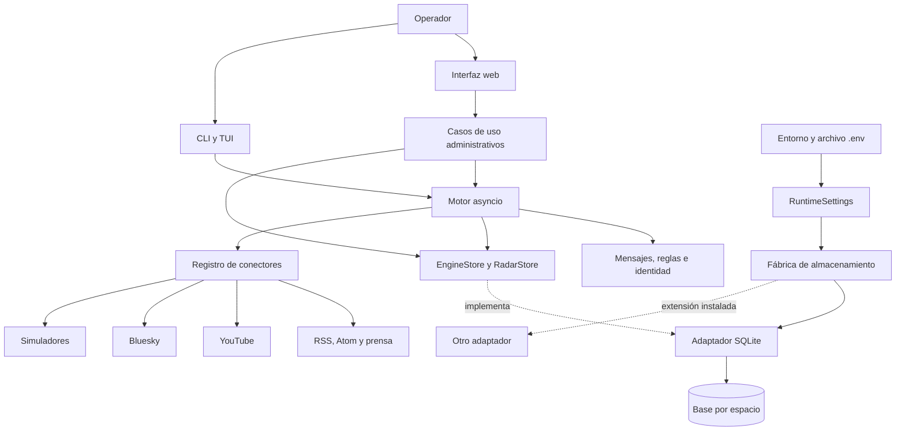
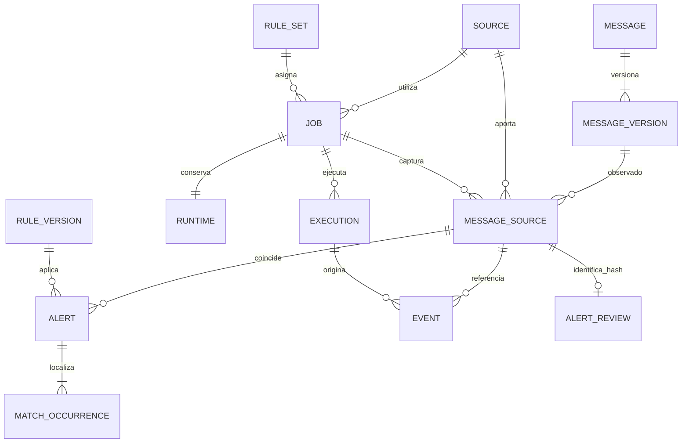

# Documento técnico de EchoScope Radar

Versión 0.11.0 · 12 de noviembre de 2026

## Herramientas

| Componente | Tecnología y función |
|---|---|
| Lenguaje | Python 3.12, asyncio |
| Interfaz administrativa | HTML, CSS y JavaScript |
| Servidor HTTP | aiohttp, loopback local y HTTPS con cuentas |
| CLI y TUI | Typer, Rich, Textual |
| Escritorio anterior | tkinter, punto de entrada alternativo |
| Validación | Pydantic 2, YAML con claves únicas, python-dotenv |
| Persistencia incluida | SQLAlchemy 2 asíncrono, aiosqlite, SQLite WAL y FileLock |
| Migraciones | Alembic 001, 002 y 003 |
| Chat | grpc.aio y bindings publicados de YouTube, extra opcional |
| XML | defusedxml |
| Credenciales | scrypt, Fernet y derivación HMAC por cuenta |
| Reportes | ReportLab, tablas y gráficos vectoriales |
| Calidad | uv.lock, Ruff, pytest, pytest-asyncio |
| Distribución Windows | PyInstaller |

Las versiones exactas están en uv.lock. Los perfiles YAML contienen las URL de fuentes y parámetros de captura.

## Arquitectura

El motor recibe almacenamiento por contrato y un registro de conectores. Administración admite inyección explícita de almacén y conectores. La composición selecciona el adaptador en bootstrap. Identidades de alerta y reglas viven en dominio. La configuración de despliegue se valida en un módulo independiente.

La presentación web todavía concentra proyecciones, validaciones y rutas. Su división adicional en controladores es un punto de evolución. La autorización y las cabeceras HTTP son middleware independientes.

## Principios SOLID aplicados

| Principio | Aplicación |
|---|---|
| Responsabilidad única | Configuración de despliegue, selección de almacén, lectura HTTP limitada, identidad de alerta y seguridad HTTP tienen módulos propios |
| Abierto/cerrado | Los conectores y adaptadores se registran por contrato |
| Sustitución | El motor consume EngineStore y los conectores cumplen contratos de lote y errores tipados |
| Segregación de interfaces | EngineStore expone captura, RadarStore agrega configuración, revisiones y ciclo de conexión |
| Inversión de dependencias | Administración admite almacén inyectado y la CLI resuelve persistencia desde composición |

## Conexión genérica

La fábrica acepta Path, ruta o URL SQLAlchemy. Las URL sqlite y sqlite+aiosqlite se resuelven al adaptador incluido. La URL se trata como secreto y los errores de configuración evitan imprimir su valor.

Un paquete externo puede publicar un entry point del grupo echoscope.storage con el nombre del backend, por ejemplo postgresql. Su fábrica recibe la URL SQLAlchemy y RuntimeSettings y devuelve un RadarStore. El paquete implementa transacciones, consultas, migraciones y coordinación de escritor para su motor. La aplicación se configura mediante ECHOSCOPE_DATABASE_URL.

Cambiar solo el driver SQLAlchemy no convierte SQL específico de SQLite en SQL de PostgreSQL. El adaptador incluido usa json_each, funciones registradas, INSERT OR IGNORE, PRAGMA y migraciones específicas. Esta versión deja el punto de sustitución y las conexiones parametrizadas. PostgreSQL, MySQL y SQL Server requieren un adaptador adicional y pruebas de contrato. El registro de autenticación del servidor continúa en accounts.sqlite.

En servidor compartido, cada cuenta usa una base dentro de su directorio derivado. La URL global de la estación no reemplaza estas bases porque mezclaría espacios de usuarios. Un adaptador compartido futuro debe conservar el aislamiento explícito por cuenta.

## Configuración de despliegue

La precedencia es argumentos explícitos de CLI, variables del proceso, archivo de entorno y valores predeterminados. Los argumentos tienen precedencia en los campos que exponen. --env-file o ECHOSCOPE_ENV_FILE selecciona un archivo. En fuente se busca .env en el directorio de trabajo. En el ejecutable se busca junto al exe. No se buscan archivos en carpetas superiores ni se expanden expresiones.

.env.example contiene los parámetros admitidos. Los valores incorrectos detienen el arranque indicando los nombres de los campos. Los secretos permanecen fuera del repositorio.

| Grupo | Variables principales, con prefijo ECHOSCOPE_ |
|---|---|
| Datos | DATA_DIR, DATABASE_URL, SOURCE_CONFIG |
| Red | BIND, PORT, DEMO_PORT, ORIGIN, TLS_CERT, TLS_KEY |
| Servidor | SERVER_DIR, MASTER_KEY, MAX_WORKSPACES, MAX_SESSIONS, SESSION_TTL_S |
| Motor | POLL_SLOTS, STREAM_SLOTS, RETRIES, SHUTDOWN_TIMEOUT_S |
| Historial | SESSION_MESSAGE_LIMIT, RETENTION_INTERVAL_S |
| SQL | SQLITE_BUSY_TIMEOUT_MS, DATABASE_POOL_SIZE, DATABASE_POOL_TIMEOUT_S |
| HTTP | API_MAX_BODY_BYTES, REQUEST_MAX_BYTES |
| Autenticación | LOGIN_ATTEMPTS_PER_MINUTE, PASSWORD_HASH_SLOTS |
| Estación | LOCAL_IDLE_TIMEOUT_S |

Las fuentes, intervalos, reglas y retención individual se configuran mediante YAML inicial y después mediante la interfaz/base activa. SOURCE_CONFIG solo inicializa una base nueva. El demo usa una base y perfil separados.

Los endpoints oficiales de protocolos y los mínimos de seguridad son contratos del conector. Las URL de recursos, credenciales y SearXNG se configuran externamente. Una nueva API con protocolo diferente requiere un adaptador.

## MER lógico

SOURCE, JOB y RULE_SET son entidades lógicas del JSON versionado de configuration. No tienen tablas físicas propias. ALERT_REVIEW utiliza un hash estable de tarea, origen, identificador externo y texto. La relación con MESSAGE_SOURCE es lógica, sin FK, y la purga elimina revisiones huérfanas. Un registro puede tener varias reglas y una sola decisión operativa.

## Esquema físico

| Tabla | Clave y relaciones |
|---|---|
| configuration | id=1, payload JSON de fuentes, tareas y reglas activas |
| runtime | job PK, habilitación, pausa, intervalo, estado, cursor y próximas fechas |
| executions | id PK, job lógico, inicio, fin y resultado |
| messages | id PK, UNIQUE(origin,external_id) |
| message_versions | id PK, FK message→messages, UNIQUE(message,digest) |
| message_sources | id PK autoincremental, FK version→message_versions, UNIQUE(job,source,version), metadata, captura y vencimiento |
| rule_versions | revision PK, rule_id y definición serializada |
| alerts | id PK, FK observation→message_sources con cascade, FK rule→rule_versions, UNIQUE(observation,rule) |
| match_occurrences | PK(alert,start,end), FK alert→alerts con cascade, término y método |
| events | id secuencial, versión, fecha, tipo, tarea, ejecución lógica y FK observation con cascade |
| audit_events | id PK, fecha, acción y destino |
| desktop_settings | key PK y value, temas, organización y vault cifrado |
| alert_reviews | item hash PK, estado y fecha del último cambio |
| account, en accounts.sqlite | name PK, salt y digest de contraseña |

Las fechas operativas se guardan en UTC ISO 8601. El texto original y sus offsets Unicode se conservan para resaltar rangos. Los índices cubren historial por tarea/fuente, expiración, eventos y ejecuciones.

## Ejecución y recuperación

Cada tarea tiene como máximo una ejecución activa. Los límites predeterminados son cuatro polling y dos streaming. La siguiente consulta se programa desde el fin de la anterior. Los reintentos transitorios usan backoff y jitter y respetan intervalos mínimos y Retry-After.

Un lote confirma estado/cursor, originales, versiones, observaciones, alertas y eventos en una transacción. Las claves únicas permiten repetirlo. El escritor usa bloqueo de proceso por base y mutex asíncrono. Un reinicio marca ejecuciones abiertas como interrumpidas y recupera el último checkpoint.

El cierre de CLI usa SIGTERM cuando corresponde. La estación web lo traduce a un evento de cierre y espera el motor con un plazo configurable. El chat de YouTube conserva hasta 200 mensajes en memoria por tarea, con checkpoint de sesión.

## Seguridad

El modo local admite loopback. El acceso en red usa cuentas y HTTPS. Las sesiones se mantienen en memoria y se invalidan al reiniciar. scrypt, sal aleatoria, límite de intentos por IP y slots de hash reducen el abuso de autenticación. El límite por IP puede afectar usuarios detrás de una misma salida de red y se puede ajustar.

Fernet cifra el vault con una clave derivada por cuenta a partir de MASTER_KEY. El archivo de cuentas y la clave TLS requieren permisos del sistema operativo. La carpeta se crea privada en Unix. La ACL de Windows la administra quien instala el servicio.

Las entradas SQL usan parámetros y los logs de SQLAlchemy ocultan sus valores. La API comprueba origen, host, cookie, token y tipo de contenido. Las decisiones deben referirse a alertas disponibles en el espacio autenticado. Los errores HTTP conservan cabeceras y los errores inesperados no exponen datos de la solicitud.

Los feeds usan HTTPS, DNS público validado en el resolvedor de la conexión, XML sin entidades, límites descomprimidos y redirecciones desactivadas. Las respuestas JSON de YouTube y Brave tienen un límite configurable. Otros conectores mantienen límites locales inferiores.

Las copias de seguridad se hacen con el motor detenido y deben incluir cuentas, bases y la clave maestra custodiada por separado. Para migrar entre motores se necesita una exportación/importación que preserve identificadores y relaciones, además del adaptador.

## Calidad

La suite cubre Unicode, reglas, deduplicación, cursores, fallos de fuentes, retención, gRPC local, TUI con Pilot, HTTP, sesiones HTTPS y aislamiento de claves. La aceptación scripts/validate-platform.py prueba puntos de entrada reales sin proveedores externos. CI valida instalación desde lockfile, lint, pruebas y aceptación en Windows y Ubuntu.

El informe final identifica los sistemas realmente probados y las limitaciones pendientes.
